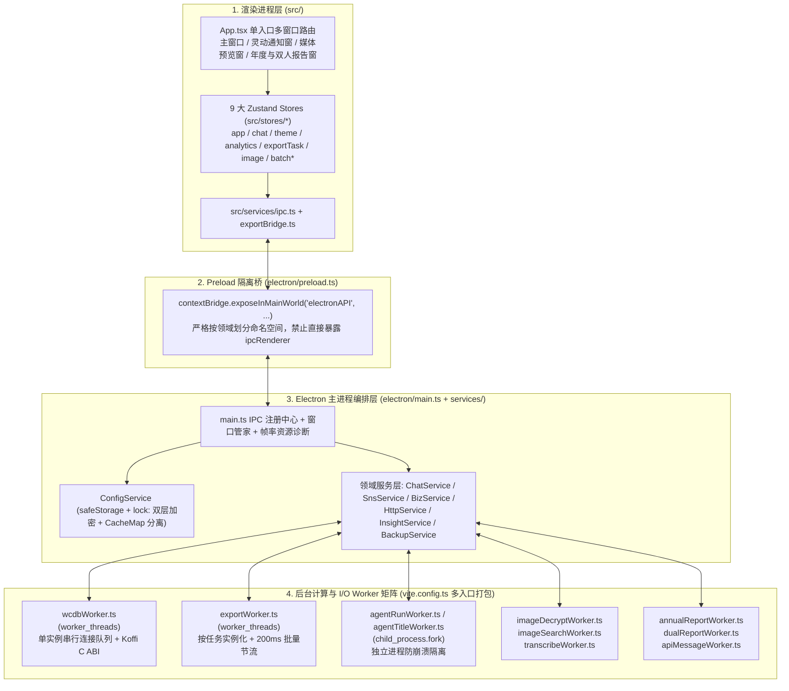
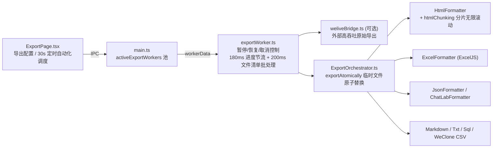

# WeFlow v5.0.0 (`v2-tag-250`) 安全审计与内部架构深度解析

> 本文档基于上游存活引用 `refs/tags/250`（Commit `91adcfdbb24e8e147d8332440b8c6ac899ad2abf`，版本号 `5.0.0`）进行全量源码级安全审计与核心架构拆解。

---

## 第一部分：安全程度全方位评估

### 1. 综合安全评级总结

| 评估维度 | 安全评级 | 核心结论摘要 |
| :--- | :--- | :--- |
| **恶意后门与防二改暗桩** | **安全（无暗桩）** | 全仓 200+ 个源码文件中**不存在**任何校验作者信息或随机篡改聊天记录的代码；已剔除全部私有闭源解密 DLL/二进制。 |
| **“云控”与网络遥测风险** | **可控（无隐私外泄）** | `cloudControlService.ts` 仅构建 6 个基础环境统计字段（不含任何消息、微信号、密钥），无远程指令执行逻辑，且受用户开关与外部动态库可选符号双重阻断。 |
| **本地敏感数据加密** | **高（双层加密）** | 数据库密钥、图片密钥、AI API Key、HTTP Token 默认经系统级 `safeStorage`（DPAPI/Keychain）加密，开启应用锁后升级为用户口令派生密钥（`lock:`）保护。 |
| **云端 AI 隐私保护** | **良好（双向脱敏）** | 发送至外部 LLM 前自动对大陆手机号（11 位）与身份证号（15/18 位含校验位）做占位符脱敏，响应返回本地后再还原。 |
| **本地 HTTP API 暴露面** | **良好（默认关闭 + 强鉴权）** | 默认关闭，开启后默认仅监听 `127.0.0.1:5031`；未设 Token 时拒绝全部请求，采用 `timingSafeEqual` 比较并限制 localhost CORS，仅开放只读与 SSE 接口。 |
| **Electron 渲染层隔离** | **中等（需注意 `webSecurity: false`）** | 全窗口强制 `contextIsolation: true`、`nodeIntegration: false` 与导航拦截，但主窗口与媒体窗为加载本地 `file://` 媒体设置了 `webSecurity: false`。 |
| **法律与开源合规性** | **高（纯接口层重构）** | 已剥离所有内存密钥扫描与 SQLCipher/图片破解实现（规避 DMCA 1201 TPM 绕过争议）；遵循 `CC BY-NC-SA 4.0` 协议，非商业个人归档与研究完全合规。 |

---

### 2. 重点安全议题逐项核查（附源码证据）

#### 2.1 社区传言核实：是否存在“改作者名随机替换消息”或隐藏后门？
- **核查结论：源码中完全不存在。**
- **源码证据**：
  - 全局检索 `hicccc77`、`com.WeFlow.app`、`author`、`VerifyUser` 后确认：`package.json` 第 14 行仅有一句静态注释 `"//": "二改不应改变此处的作者与应用信息"`，没有任何运行时代码读取或校验该字段。
  - 早期社区传言的校验逻辑存在于 Era 1 分发的闭源原生动态库内部，而 `v2-tag-250` 已彻底移除了该闭源库。
  - `electron/services/wcdbCore.ts` 第 1352、4718 行的 `VerifyUser` 仅被 `electron/services/windowsHelloService.ts` 调用，用于向操作系统请求原生 Windows Hello 生物识别弹窗解锁应用锁。
- **仓库内二进制文件全量清单（共 5 个标准文件，零私有黑盒插件）**：
  - `resources/runtime/win32/{msvcp140.dll, msvcp140_1.dll, vcruntime140.dll, vcruntime140_1.dll}`：标准 Microsoft VC++ 运行时库。
  - `electron/assets/wasm/wasm_video_decode.wasm`：用于解码微信视频容器的标准 Emscripten WebAssembly 解码模块。

#### 2.2 “云控服务” (`cloudControlService.ts`) 源码真相
- **文件位置**：`electron/services/cloudControlService.ts`（全文件仅 248 行）。
- **实际行为**：
  1. **没有任何“远程控制/下发配置/远程开关”代码**，仅是一个带断路器（Circuit Breaker）的定时在线状态上报缓冲队列（每 5 分钟一次）。
  2. 上报结构体 `UsageStats`（第 4–11 行）严格固定为 6 个字段：
     - `appVersion`：应用版本号
     - `platform`：操作系统名称与版本（如 `Windows 11`、`macOS`、Linux 发行版名）
     - `deviceId`：`md5(os.hostname() + os.platform() + os.arch())`
     - `timestamp`：毫秒时间戳
     - `online: true`
     - `pages`：访问过的前端路由名集合（不含参数与敏感内容）
  3. **双重阻断机制**：
     - 前端 `src/App.tsx`（第 307–319 行）仅在 `analyticsConsent === true`（用户主动开启数据收集同意开关，设置页默认 `false`）时才会初始化并记录路由。
     - 后端第 38、104 行通过 `wcdbService.cloudInit` / `wcdbService.cloudReport` 委托给外部 `wcdbLibPath` 动态库的 `wcdb_cloud_*` 可选导出函数执行——TypeScript 层本身不包含任何上报服务器 URL；若外部动态库不导出这两个可选符号，上报直接静默跳过。

#### 2.3 全仓库硬编码外联域名清单
除用户自行配置的 AI BaseURL 外，全仓源码涉及的外部网络端点仅包含以下 6 类业务按需请求：

| 类别 | 涉及文件 | 目标域名 / 地址 | 触发条件 |
| :--- | :--- | :--- | :--- |
| **版本更新与外链** | `electron/main.ts`、`src/pages/SettingsPage.tsx` | `github.com/hicccc77/WeFlow`、`weflow.top`、`chatlab.fun` | 检查更新（`autoDownload = false`）或用户点击外链 |
| **AI 供应商目录与中转** | `electron/services/aiProviderCatalog.ts`、`relayOneService.ts` | OpenAI / Anthropic / Gemini / DeepSeek / Moonshot / 阿里云 / 智谱 / OpenRouter / `aiapi.aiqji.cn` (RelayOne) / `models.dev` | 用户配置对应 AI 模型或登录 RelayOne 服务 |
| **AI 联网搜索** | `electron/services/webSearchService.ts` | `www.bing.com/search`、`html.duckduckgo.com/html/` | 用户在 AI Agent 中启用 `web` / `auto` 联网检索工具时 |
| **离线语音模型下载** | `electron/services/voiceTranscribeService.ts` | `modelscope.cn`（SenseVoice ONNX 开源模型） | 用户首次下载本地离线语音转文字模型时 |
| **微博社交上下文** | `electron/services/social/weiboService.ts` | `weibo.com`、`m.weibo.cn` | 用户在 AI 洞察中主动填入微博 Cookie 并绑定联系人时 |
| **位置消息地图瓦片** | `src/pages/ChatPage.tsx` | `webrd01.is.autonavi.com`、`uri.amap.com` | 聊天页渲染地理位置卡片或点击外部打开地图时 |

#### 2.4 审计发现的 3 个安全注意项（使用建议）
1. **外部可插拔原生组件的信任边界（高优先级使用原则）**
   - v5.0 将底层能力外包给用户在设置页指定的 5 个外部路径：`wcdbLibPath`、`keyProviderPath`、`imageNativeAddonPath`、`welivePath`、`imgHelperLibPath`。这些动态库/子进程均以当前系统用户权限直接加载执行且不做签名校验。**请仅使用你自己编译或完全信任源码来源的插件，切勿运行来历不明的预编译 DLL/EXE。**
2. **渲染窗口 `webSecurity: false`（中等风险架构权衡）**
   - `electron/main.ts` 在主窗口（第 1129 行）及独立图片/视频预览窗（第 1555、1614 行）设置了 `webSecurity: false` 以直接加载本地 `file://` 媒体文件。虽然已配合 `contextIsolation: true`、`nodeIntegration: false`、`protectRendererNavigation` 导航白名单及 `dompurify` 消毒，但仍建议不要在未受信网络环境下将 AI 模型 BaseURL 指向恶意服务端返回未过滤载荷。
3. **`imageDownloadService.ts` PowerShell 参数拼接细节（低风险）**
   - `electron/services/imageDownloadService.ts` 第 62–68 行将设置项 `imgHelperProcessName` 仅转义单引号后拼入 PowerShell `-Command` 模板。因该配置仅限本地用户在设置界面填写，无外部输入面，保持常规进程名（如 `Weixin.exe`）即可安全运行。

---

## 第二部分：WeFlow v5.0.0 内部架构深度解析

### 1. 总体分层与 10-Worker 多线程/多进程拓扑

WeFlow 是一个重度本地数据密集型桌面应用（往往需要同时处理数 GB 加密 SQLite 分库、数万张加密 `.dat` 图片、SILK 语音离线 ASR 转写以及长上下文 LLM Agent 循环）。为保证 UI 恒定 60/120fps 流畅度，项目采用了 **“轻主进程路由 + 全懒加载多窗口渲染层 + 10 专用后台 Worker”** 的解耦架构：



#### 构建期虚拟 Electron Shim 机制（`vite.config.ts`）
在 Worker 线程或 `child_process.fork` 的纯 Node 进程中，大量复用的 `electron/services/*` 模块会 `import { app, safeStorage, BrowserWindow } from 'electron'`，而在非主进程环境下这些对象不存在。
`vite.config.ts`（第 51–127 行）通过自定义插件 `exportWorkerElectronShimPlugin()` 拦截编译产物，将 `'electron'` 导入重写至虚拟模块 `virtual:weflow-export-worker-electron`：
- 通过环境变量 `WEFLOW_USER_DATA_PATH` 还原 `app.getPath('userData')`；
- 将 `app.on('will-quit')`、`BrowserWindow`、`Notification` 等主进程生命周期 API 映射为安全的 No-op 桩函数，从而实现了**一套领域服务代码在主进程与后台 Worker 间零侵入复用**。

---

### 2. 数据底座层：`WcdbService` ↔ `wcdbWorker` ↔ `WcdbCore`

数据库访问链路采用经典的三层代理设计：

1. **主进程异步代理（`electron/services/wcdbService.ts`）**
   - 维护自增 `messageId` 与 `pending: Map<number, { resolve, reject }>`，将所有数据库方法封装为非阻塞 Promise RPC。
   - **连接串行队列与维护锁**：通过 `connectionOperationQueue` 串行化 `open`/`close`/`testConnection`，并提供引用计数式的 `enterMaintenance()` / `exitMaintenance()`（在进行备份恢复 `backupService` 时挂起常规查询，防止 SQLite 锁冲突或句柄悬空）。
2. **工作线程宿主（`electron/wcdbWorker.ts`）**
   - 运行在独立 `worker_threads` 中，持有唯一的 `WcdbCore` 实例，并将底层监控管道收到的数据以 `{ type: 'monitor', payload }` 主动回推主进程。
3. **C ABI 动态绑定与缓存核心（`electron/services/wcdbCore.ts`，5,233 行）**
   - **按需符号绑定（Graceful Degradation）**：通过 `koffi.load(dllPath)` 加载动态库。除 `wcdb_init`、`wcdb_shutdown`、`wcdb_open_account`、`wcdb_close_account`、`wcdb_free_string` 5 个必选符号外，其余 90+ 个 C 接口全部通过 `bindOptionalExport()` 绑定——第三方实现缺失任何高级接口时仅将该能力标记为 `null`，绝不会导致整个应用启动崩溃（由 `scripts/check-wcdb-optional-exports.cjs` 单元测试保障）。
   - **内存安全管理**：所有 C 层分配的 `_Out_ void** outJson` 字符串指针，在 `koffi.decode(..., 'char', -1)` 解码为 JS 字符串后，均在 `finally` 块中立即调用 `wcdbFreeString(outPtr[0])` 释放原生堆内存，并定期触发 `wcdbPurgeMemory()`。
   - **游标流式扫描**：针对导出与全局统计等百万级消息读取场景，提供 `wcdb_open_message_cursor` → `wcdb_set_message_cursor_projection`（按列裁剪载荷）→ `wcdb_fetch_message_batch` → `wcdb_close_message_cursor`，避免一次性全表 JSON 序列化撑爆内存。
   - **实时消息监控管道（`startMonitor`）**：启动原生管道（Windows Named Pipe `\\.\pipe\weflow_monitor_*` 或 Unix Domain Socket），由 Node `net.connect` 订阅微信底层新消息与撤回事件，驱动主界面实时刷新、灵动岛风格通知窗（`notificationWindow.ts`）以及 SSE 推送（`messagePushService.ts`）。
   - **多级 TTL/LRU 缓存**：内置 `displayNameCache`（20,000 条 / 10 分钟）、`avatarUrlCache`、`imageHardlinkCache`、`videoHardlinkCache` 与 `mediaStreamPageCache`（支持 Inflight 请求合并去重）。

---

### 3. 聊天解析与配置分离设计（`ChatService` & `ConfigService`）

- **全消息类型解析器（`electron/services/chatService.ts`，14,818 行）**
  - 处理微信复杂的消息存储形态：Zstandard 压缩字段解压（`fzstd`）、单聊/群聊发送者前缀剥离、Type 49 复合 XML（引用回复、合并转发记录、文件、音乐、小程序、转账、红包、视频号卡片、位置卡片）结构化提取。
  - 结合持久化缓存层（`MessageCacheService`、`ContactCacheService`、`SessionStatsCacheService`、`RelationshipJourneyCacheService`），避免每次冷启动重扫全库。
- **高频配置读写优化（`electron/services/config.ts` + `cacheMapStore.ts`）**
  - 早期版本将头像/统计等大型键值缓存存入同一个 `electron-store` 主配置文件，导致文件膨胀至 3.2MB，每次同步读写阻塞主线程。
  - v5.0 将所有以 `CacheMap` 结尾的大体积缓存键自动分流至独立的异步延迟刷盘存储 `CacheMapStore`，保证主配置文件极小且秒级响应。

---

### 4. 多格式流式导出引擎（`electron/exportWorker.ts` + `electron/services/export/`）

导出模块采用 **Facade + Context + Orchestrator + Strategy Formatters** 标准分层：



- **原子写入保证（`ExportOrchestrator.exportAtomically`）**：所有单会话导出先写入同目录下的隐藏临时文件 `.{baseName}.weflow-partial-{pid}-{rand}.{ext}`，校验文件非空且未被用户取消后，再通过 `fs.promises.rename` 原子替换为目标文件；中途取消或报错会自动清理残余临时文件。
- **8 种导出格式器（`electron/services/export/formatters/`）**：支持 HTML（内置 `htmlChunking.ts` 与 `htmlInfiniteScrollScript.ts`，十万条消息离线网页打开依然流畅滚动）、ChatLab 标准 JSON、详细 JSON、Excel、Markdown、TXT、PostgreSQL SQL 脚本以及 WeClone 微调训练集 CSV 格式。
- **IPC 洪泛抑制（`exportWorker.ts`）**：批量导出海量表情/图片附件时，若每创建一个文件就发一次 `postMessage` 会打满主进程事件循环；`exportWorker` 设计了 `CREATED_PATH_FLUSH_INTERVAL_MS = 200ms` / 256 条上限缓冲池与 `PROGRESS_POST_INTERVAL_MS = 180ms` 节流器。

---

### 5. Model-Led AI Agent 与长期记忆子系统（v5.0 核心架构升级）

v5.0 在 `electron/services/agent*.ts`（共 25 个模块）构建了一套完整的**本地聊天记录深度研究 Agent（Standard / Deep-Research 双模式）**：

```mermaid
sequenceDiagram
    participant UI as AgentPage (Renderer)
    participant Main as main.ts (Supervisor)
    participant Worker as agentRunWorker (Forked Process)
    participant Loop as AgentModelLedService (ToolLoopAgent)
    participant Redact as AgentTextRedactionSession
    participant DB as ChatService / SnsService / MemoryStore

    UI->>Main: 发起提问 (Scope: Global / Session + Filters)
    Main->>Worker: child_process.fork 隔离运行 (支持崩溃恢复评估)
    Worker->>Loop: prepareAgentContext (超 82% 窗口自动摘要折叠)
    Loop->>DB: 加载长期记忆摘要 + 按需动态解锁工具 (agentToolCatalog)
    loop 多步自主调查循环 (Investigation Plan & Raw Reading)
        Loop->>DB: 时间线覆盖图 / 词法锚点定位 / 原始消息分页读取 / 语音转写
        DB-->>Redact: 返回原始聊天片段
        Redact-->>Loop: 手机号与身份证号替换为【手机号#N】占位符
        Loop->>Loop: 调用云端/本地 LLM (支持 Anthropic/OpenAI Prompt Cache)
    end
    Loop->>DB: AgentMemoryMutationTransaction 幂等更新长期记忆 (Envelope v7)
    Loop->>Redact: restoreText 将占位符还原为本地真实文本
    Redact-->>UI: 流式推送 UIMessageChunk 最终回答与引用溯源
```

#### 五大关键工程设计亮点：
1. **独立子进程崩溃隔离与断点恢复（`agentProcessLifecycle.ts` + `agentRunStore.ts` + `agentResumeState.ts`）**
   - Agent 运行在 `child_process.fork` 独立子进程中；即使原生分词（`jieba-wasm`）或超大上下文导致 V8 OOM，也不会拖垮主窗口，且 `AgentRunStore` 会持久化研究轨迹，支持异常中断后的状态恢复评估。
2. **渐进式工具解锁目录（`agentToolCatalog.ts`）**
   - 初始轮次仅向模型暴露极简工具（如 `read_memory` 与可选联网搜索），减少无关工具 Schema 对首轮 Token 与注意力的干扰；模型可通过 `request_tools` 在运行期按需申请挂载会话搜索、原始分页读取、朋友圈查询、媒体审查等深层工具。
3. **面向百万条聊天记录的“无向量库原始阅读器”（`agentRawReadingCore.ts`）**
   - 摒弃传统脆弱的 RAG 碎片化切片，改为向模型提供**结构化时间线覆盖图（Timeline Coverage Map）+ 词法锚点（Lexical Anchors）+ 高密度对话段采样 + 双向游标分页阅读（Raw Page Cursor）**，并配合本地磁盘缓存 `agentRawPageCache.ts`，让大模型像人类调查员一样按月份/日期/锚点翻阅完整上下文。
4. **双阈值自适应上下文压缩器（`agentContextManager.ts`）**
   - 实时估算消息流与工具输出的 Token 预算：当达到模型上下文窗口的 **82%（`NORMAL_TRIGGER_RATIO`）** 时，自动裁剪早期工具大载荷并将历史轮次摘要折叠至 **52%（`NORMAL_TARGET_RATIO`）**，仅保留最近 6 条完整消息；若触发服务商上下文溢出错误（`provider-overflow`），则启动强制压缩模式压降至 **32%（`FORCE_TARGET_RATIO`）** 后自动重试。
5. **事务级长期记忆引擎（`agentMemoryService.ts` + `agentMemoryMutationTransaction.ts` + `agentMemorySynthesisService.ts`）**
   - 记忆存储采用带版本号乐观锁（`revision`）与已处理轮次去重表（`processedTurnIds`）的 `MemoryEnvelope v7` 结构，涵盖 9 大分类（`identity`、`preference`、`relationship`、`project`、`communication`、`habit`、`goal`、`event`、`other`）。
   - 单轮对话中的显式记忆写入受 `AgentMemoryMutationTransaction` 密封事务保护：首次声明意图清单后立即 `sealed` 锁定，基于 `sha256(content + category)` 指纹防止模型在多步工具循环中重复提交、篡改意图或产生并发写冲突。

---

### 6. 前端渲染与多窗口单页架构（`src/`）

- **单构建产物驱动 9 类桌面窗口（`src/App.tsx`）**：
  主窗口（`1400×900`）、用户协议窗（`/agreement-window`）、新手引导窗（`/onboarding-window`）、视频播放窗（`/video-player-window`）、图片查看窗（`/image-viewer-window`）、独立聊天记录窗（`/chat-history/*`）、桌面右上角透明液态玻璃通知窗（`/notification-window`）、年度报告窗（`/annual-report/view`）与双人报告窗（`/dual-report/view`）共享同一套 React 路由入口。
- **极致首屏内存控制**：
  除首屏壳组件 `HomePage` 外，其余 27 个重型业务页面全部使用 `React.lazy()` 拆分为独立异步 Chunk；常驻后台的通知小窗仅加载极小的通知组件 Chunk，大幅降低多渲染进程常驻内存。
  此外，`ExportPage` 与 `AgentPage` 采用“按需挂载 + 状态保活”策略（如存在已启用的自动化定时导出任务时，后台静默挂载导出调度器）。
